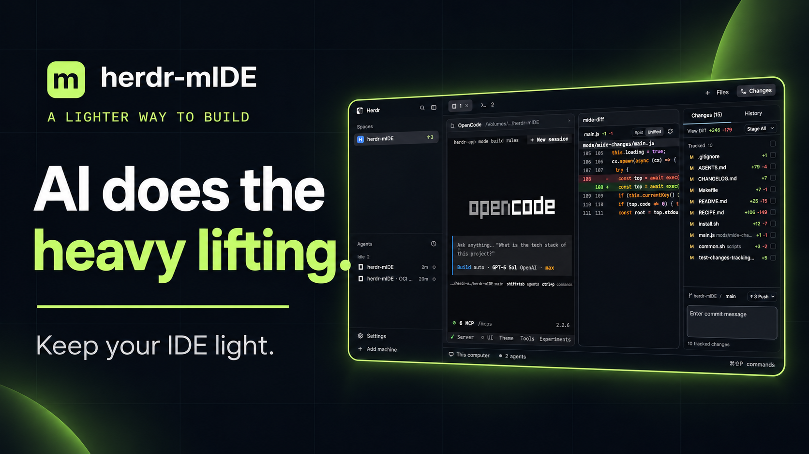
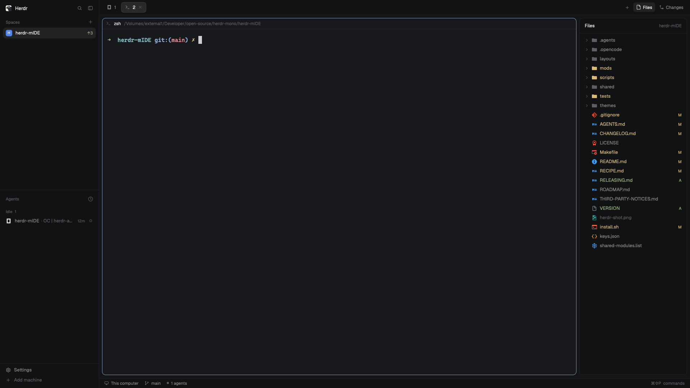
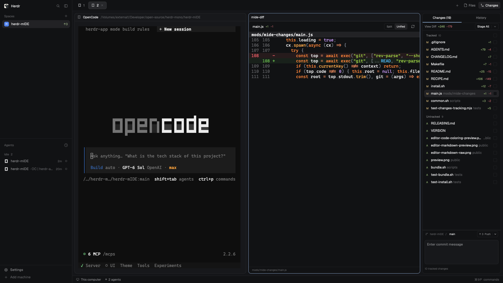
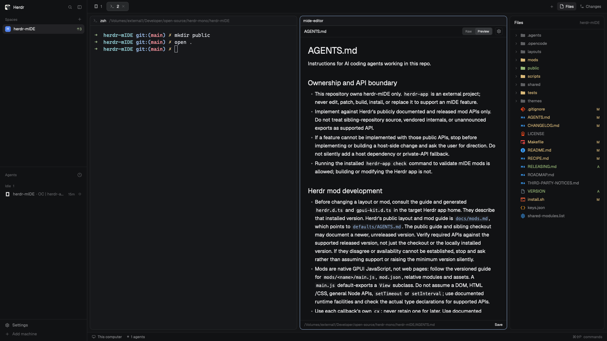

# herdr-mIDE

> The minimal IDE for [Herdr](https://herdr.dev) — built for the age of AI-assisted coding.

**herdr-mIDE** is a layout + mod package for the [Herdr app](https://herdr.dev): a better file manager, a better git panel, and a minimal editor — all living inside the same window as your terminals and coding agents.

Most of the coding work today is done by AI agents. What's left for us is the _last mile_: review what the agent changed, make small surgical edits, stage the right files, and ship. Existing IDEs are built for a world where you write all the code. **herdr-mIDE is built for the world where you don't.**



**Watch the one-minute herdr-mIDE demo:**

https://github.com/user-attachments/assets/1ef638c1-5d45-427a-9276-308a471030c1

The screenshots below show a development workspace. Review the video and images
for private information before sharing them outside this repo.

## What's inside

### 📁 Files — a file manager that tells you everything at a glance

- **File-type icons** — a curated Material Icon Theme set (MIT): full-color icons for common file types, plus open/closed folder states in the tree; unknown files fall back to the theme's plain file icon.
- **Git status baked into the tree** — the whole file name is colored: 🟡 modified or conflicted, 🟢 new/untracked, 🔴 deleted, plus a bold status letter.
- Lazy folders, `.git` and `.DS_Store` hidden, live refresh from the folder watch.
- **Click a file to edit it** — it opens in the editor pane beside your terminal.



### 🌿 Changes — a git panel for the review-and-commit loop

- **Tracked and Untracked groups** — each file has a tri-state staging checkbox; partially staged files stay visible as partially staged.
- **Stage All / Unstage All** — one split action stages every change or clears the index, with per-group selection too.
- **Detailed diff view** — line-numbered, tinted additions/deletions, smooth on big diffs.
- **Commit flow** — submit a message to commit staged files; if none are staged, tracked edits are staged and committed without including untracked files.
- **Branch switcher** — switch, create, and delete branches without leaving the panel.



### ⌨️ Editor — a minimal editor pane

- Syntax highlighting, a Save button, optional ⌘S shortcut, and an unsaved indicator.
- Editor syntax uses Ayu Dark; Git status colors use Zed One Dark values, and diff colors use the bundled palette. Other UI colors—including focus, controls and backgrounds—follow Herdr's theme without changing the app or terminal theme.
- **Vim mode is on the roadmap** — Herdr's built-in editor exposes no cursor API, so modal editing arrives as a custom editor core (see [ROADMAP](./docs/ROADMAP.md)).



### More screenshots

- [Markdown in the Raw editor](public/examples/editor-markdown-raw.png) · [Syntax-highlighted JavaScript](public/examples/editor-syntax-highlighting.png)
- [Staging files and writing a commit message](public/examples/changes-staging-commit.png) · [Commit history](public/examples/changes-history.png)
- [Branch switcher](public/examples/changes-branch-switcher.png) · [Branch delete control](public/examples/changes-branch-delete.png) · [Remote actions menu](public/examples/changes-remote-actions.png)

## Install

The layout is based on [Herdr app](https://herdr.dev) 0.1.13 and is verified
against the released app on every platform we could test: automated checks and
live interaction checks on macOS, automated checks plus partial live coverage
on Linux and Windows — see [docs/TESTING.md](./docs/TESTING.md) for the exact
per-platform matrix and its known gaps.
The source installer below needs a POSIX shell; Git is needed for Git features.
Mods run with your access: Files reads your workspace, Editor can write files,
and Changes runs Git, including network operations when requested. Review the
source and [Herdr's security guidance](https://github.com/herdrdev/herdr-app/blob/master/docs/security.md) before installing.

```sh
git clone https://github.com/SOUMITRO-SAHA/herdr-mIDE
cd herdr-mIDE
./install.sh
herdr-app do layout.switch --name herdr-mide
```

The installer copies the mods and layout into `~/.config/herdr-app` (or `HERDR_APP_HOME`), skipping existing names without modifying them, prints the key bindings to merge into your `keys.json`, and runs `herdr-app check` on newly installed mods. Skipped existing folders are not checked and may belong to another version: review conflicts before continuing. It does not install or switch a Herdr or CLI theme. `ctrl-shift-l` cycles layouts; deleting the installed files removes this bundle.

If a copy or check fails, installation may be partial; inspect the reported
files before retrying. A retry skips existing names rather than repairing them.

Use **Save** in the editor to write changes to disk. The footer briefly shows **Saved** after the current contents are written, and the unsaved dot disappears. To also save from the keyboard, merge the printed `mod:mide-editor` bindings (`cmd-s`, and `ctrl-s` on Windows and Linux) into your Herdr `keys.json`; the installer does not change your existing keys.

The no-clobber installer is not an upgrade tool. `just sync` is for development: it overwrites the installed mIDE layout and replaces mod-folder contents, including local edits, while leaving theme files and settings alone. Back up and review existing customizations before a manual upgrade.

Herdr's native editor and input controls resolve internal colors (including editor background, caret and selection) from the app theme; the current mod API only exposes syntax-color overrides. The native editor's background can therefore differ from Herdr's sidebar. Ayu applies to syntax, while Git colors use the bundled palette; other UI colors follow Herdr.

This repository root **is** the complete, installable package — Editor and Diff
carry their auto-generated `_shared` syntax (banner-marked; regenerate with
`just shared`, never by hand) and every mod folder carries the license and
notices. Use the installer above or copy the layout and mod folders directly.
Published to the Herdr Gallery on 2026-11-12 (repository topic `herdr-layout`).

## How it works

herdr-mIDE doesn't fork Herdr — it rides on it. The Herdr app redraws its whole interface from files (layouts are JSON trees, panels are small JavaScript mods with a GPU UI), and it hot-reloads them while it runs. That gives herdr-mIDE terminals, agents, themes, spaces and remote machines for free, and makes every file in this repo live-editable.

```
layouts/herdr-mide.json   the window: Herdr's main layout with mIDE panels
mods/mide-files/          file tree · type icons · git-status colors
mods/mide-changes/        staging · commit · branches
mods/mide-diff/           git diff pane · split/unified · refresh
mods/mide-editor/         editor pane · save · shared mIDE syntax palette
themes/ayu-dark.json      Ayu reference palette (MIT; not installed as a host theme)
keys.json                 optional bindings: cmd/ctrl-shift-e editor split, cmd/ctrl-s save
mods/mide-files/icons/    all icons: material/ (file types) · folder/chevron glyphs
justfile                  the entry point: dev, sync, test, check, install, status, shot, switch, bundle, smoke-*
VERSION                   version of the complete layout + four-mod bundle
scripts/                  the logic behind the commands (shared common.sh)
install.sh                first-time installer (never overwrites)
```

All icons live in `mods/mide-files/icons/` — the single source of truth. File-type and folder icons come from Material Icon Theme (the only icon source).

[RECIPE.md](./RECIPE.md) documents the build for humans and agents. The maintainer guides live in [docs/](./docs): [docs/TESTING.md](./docs/TESTING.md) covers automated and isolated desktop checks across platforms, [docs/RELEASING.md](./docs/RELEASING.md) covers versioning and the Herdr Gallery standard with its publication steps, and [docs/ROADMAP.md](./docs/ROADMAP.md) has the plan.

## Development

Every command lives in the root `justfile`:

```sh
just dev        # live loop: sync on every save, Herdr hot-reloads in place
just sync       # one-shot copy into ~/.config/herdr-app
just test       # source tests for shared helpers and palette boundaries
just check      # herdr-app check every mod (the runtime's own parser)
just fmt        # format the tree (Prettier via Bun; bun install once)
just fmt-check  # verify formatting; CI enforces this on every PR
just install    # first-time install (never overwrites; prints keys to merge)
just status     # window state + errors from files and mods
just shot       # screenshot of the window → herdr-shot.png
just switch     # show the herdr-mide layout (ctrl-shift-l cycles back)
just bundle     # build a copyable layout bundle; needs a reviewed preview.png
just smoke-prepare  # prepare a disposable app home and Git fixture
just smoke-capture  # check and capture a user-started test window; see docs/TESTING.md
```

`preview.png` is the project's preview artwork. `just bundle` packages it for
Herdr's gallery; it only checks that the file exists, so review the image,
other screenshots and demo video for private information before publishing.

The typical loop: `just dev` in one terminal, edit in your editor — each save lands in the app home within a second and Herdr reloads the mod in place. A broken save keeps the last good version running and reports in `just status`; `just shot` is the fastest visual check. Both respect `HERDR_APP_HOME`, and `just dev interval=0.3` polls faster. If a bad layout or keys edit ever wedges the window, `ctrl-alt-shift-escape` is Herdr's built-in escape hatch back to the default `main` layout.

Scripts live in `scripts/` — `dev.sh` (the watch loop) and `sync.sh` (one-shot copy) share `common.sh`, which defines the app home, the sync rules and the mod list exactly once. New scripts belong there, called from the justfile; only `install.sh` (the no-clobber installer) stays at the root beside it.

`shared/syntax.js` owns mIDE's single syntax palette and lightweight tokenizer; the editor and Diff consume it through generated mod-local copies. It uses the documented `EditorState` syntax option and tokenizes Diff lines locally, without depending on extra host APIs. Git status/diff UI colors remain mod-specific. `themes/ayu-dark.json` is a non-runtime Ayu reference and intentionally does not duplicate syntax colors.

## Contributing

Issues first: every pull request starts with a tracked issue, claimed with a
`/claim` comment before work begins, and the PR links back to it (`Fixes #N`)
so the discussion closes on merge. Claimants get merge priority; never race
someone on an already-claimed issue — comment asking for status and ETA
instead. Branch `<type>/<issue-number>-<slug>`, commit `type(scope): summary`,
and keep `just fmt-check`, `just test` and (for mods) `just check` green. The
full flow and merge gate are in [CONTRIBUTING.md](./CONTRIBUTING.md).
Everyone works under the [Code of Conduct](./CODE_OF_CONDUCT.md); security
problems are reported privately as described in [SECURITY.md](./SECURITY.md)
— never as a public issue.

## Status

**v0.0.1 (2026-11-12).** Automated checks are green and the interactive workflows were verified live on macOS; Linux and Windows coverage is partial and tracked, with known gaps, in [docs/TESTING.md](./docs/TESTING.md). `herdr-app check` covers initial mod rendering, not the complete interaction matrix. Vim mode, hunk-level staging and the agent-review flow are future work. See the [roadmap](./docs/ROADMAP.md).

## License

[Apache-2.0](./LICENSE) © 2026 SOUMITRO-SAHA — with third-party icons, palettes and adapted code under their own licenses; see [THIRD-PARTY-NOTICES.md](./THIRD-PARTY-NOTICES.md).
