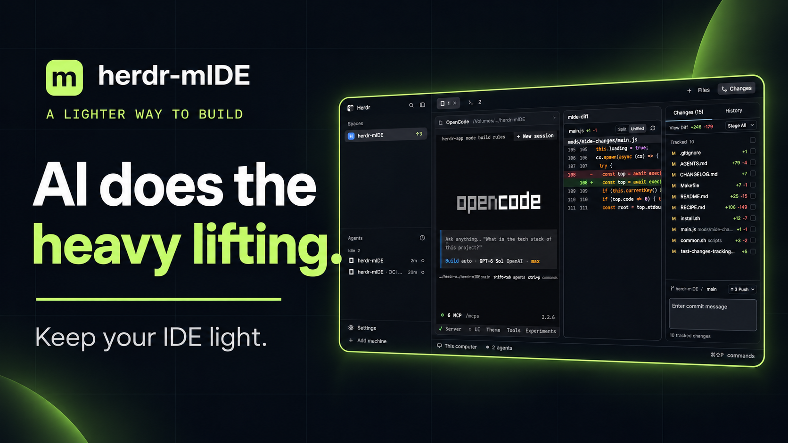

# herdr-mIDE

Herdr's window with a minimal IDE in the right-hand panel: a **Files** panel
that shows file-type icons and colors each file by its git status, and a
**Changes** panel with staged and unstaged groups, per-file staging, a
detailed diff, a guided commit and an inline branch switcher. Clicking a file
in Files opens it in an editor pane beside the terminal, with syntax
highlighting, ⌘S save and a theme cycler in its status bar.

## What you see

- **Everything of Herdr's `main` layout** (sidebar, tab bar, panes, status
  bar) with the panel stack holding two mIDE blocks: `files` (mod
  `mide-files`) and `changes` (mod `mide-changes`), 440px wide by default
  (300 to 900px), opened from the tab bar's Files and Changes buttons like
  the shipped panels.
- **The Files panel** (`mide-files`, 42px header "Files" + folder name,
  26px rows): a lazy tree with chevrons and theme-tinted **solid folder
  glyphs** — muted when clean, colored by the most severe change underneath
  (orange modified, red deleted, green new), swapping to an open glyph
  while expanded — file names one step muted against the foreground and
  ghosted when git-ignored (dependencies, build output, local secrets),
  taking their change color when modified — and a full-color
   **Material Icon Theme icon** for files (MIT, © Material Extensions;
   credited in THIRD-PARTY-NOTICES.md). `icons.js`, generated by
   `scripts/update-icons.sh` from the theme's own associations, maps
   1332 suffixes (multi-dot ones like `docker-compose.yml` included)
   and 1084 whole names (`package.json` → nodejs, `Cargo.lock` → lock…).
   Match order: exact name, then longest dotted suffix, then the
   theme's default file glyph for unknown types. The **whole
  file name is colored by git status**: orange (`theme().blocked`)
  modified, green (`ansi2`) added/untracked, red (`ansi1`) deleted or
  conflicted, with a small bold status letter (`M`, `A`, `D`, `U`) on the
  right.
- **The Changes panel** (`mide-changes`, 42px header): "Changes", a count
  pill, total `+`/`−` in green/red, and a branch chip `⑂ <branch>` on the
  right (bordered, opens the branch view). Below, the file list in two
  groups with 11px semibold labels: **STAGED** and **CHANGES** (plus
  "stage all" on the CHANGES label row). Each 28px row: a bold colored
  status letter, dim folder path + bright name, per-file `+N`/`−N`, and an
  action on the right — `+` to stage (work side) or `−` to unstage (index
  side). Below the list, the **diff**: 20px rows, unified, line numbers,
  green-tinted additions (`ansi2 + "18"`), red-tinted deletions
  (`ansi1 + "18"`), `@@` hunk headers on `raised`, on a virtual list with
  its own scrollbars. At the bottom: a commit message input (32px, accent
  border while focused) and a **Commit N** button (solid while enabled,
  where N is the staged count).
- **The branch view** (inside `mide-changes`, replaces list + diff while
  open): 28px branch rows (selected background on the current one,
  "current" label, "delete" in red on hover for others), and a "branch
  name" input with a **New** button that creates and switches.
- **The editor pane** (`mide-editor`, opened by clicking a file in Files or
  `cmd-shift-e`): a 36px header with an `EDIT` mode chip, the file name, an
  orange `●` while unsaved and a **Save** button; the code with syntax
  highlighting (13px, the settings font); a 28px status bar with a theme
  cycler `◐ <name>`, the full path, and an `⌘S save` hint.

## How it behaves

- **Files** expands a folder on click (lazy, one `sh`/PowerShell listing per
  folder, 500 entries per folder / 5,000 total, `.git` and `.DS_Store`
  hidden); clicking a
  file runs `pane.split {direction: right, mod: mide-editor, props: {file}}`
  beside the terminal. Git marks refresh with the folder watch and every
  10s; modified/added/deleted coloring follows `git status
  --porcelain=v1` per path.
- **Changes** refreshes on the repo's folder watch and every 10s. Clicking a
  row toggles its diff (staged rows diff `--cached`, unstaged `git diff`,
  untracked files read as all-additions); the first file's diff shows until
  you pick another. `+` on a work row runs `git add -- <path>`, `−` on an
  index row `git restore --staged -- <path>`, "stage all" runs `git add -A`.
  **Commit** runs `git commit -m <message>` with the staged files only — it
  is disabled (dim, no cursor) until a message and at least one staged file
  exist. Enter in the message input commits.
- **The branch chip** opens the branch view: clicking a branch runs `git
  switch`, **New** runs `git switch -c`, "delete" runs `git branch -d`;
  every action refreshes the panel; Escape (or the chip) returns to the
  changes view.
- **The editor** loads `props().file`, marks dirty on any edit, saves with
  the **Save** button, `mide-editor.save` (bound to `cmd-s` in
  `keys.json`'s `mod:mide-editor` section) and shows `Save failed: …` on
  error. The status bar's theme cycler (or `mide-editor.theme` on
  `cmd-alt-t`) steps through `themes()` with `app.theme`, remembering the
  pick in shared state `mide.theme`.

## Built from

- **Layout** `layouts/herdr-mide.json`: a clone of Herdr 0.1.13's `main`
  (`cloned_from: {name: "main", version: "0.1.13"}`); only the `panel-body`
  stack's two blocks point at `mide-files` and `mide-changes`, the panel is
  440px, and the shipped `tabs` mod is kept — its Files and Changes buttons
  already toggle the `files` and `changes` block ids.
- **`mods/mide-files`**: `main.js` (tree, marks, icons, open-in-editor),
  `icons/` (folder + chevron glyphs) and `icons/material/` (523 Material Icon Theme SVGs — exactly the set the
  map references), `icons.js` (the generated suffix/name map). Herdr
  functions: `spaces`, `panes`, `focused`, `exec`, `watchFolder`,
  `theme`, `run`. Folder listing adapted from Herdr's shipped `files`
  mod (Apache-2.0). All icons live in the mod itself
  (`mods/mide-files/icons/` — the single source of truth).
  Regenerate the file-type set with `scripts/update-icons.sh` (fetches
  the material-icon-theme npm package — Material Icon Theme is the only
  icon source in this project).
- **`mods/mide-changes`**: `main.js`. Herdr functions: `spaces`, `panes`,
  `focused`, `exec`, `readTextFile`, `watchFolder`, `theme`, `settings`.
  Diff rows and the virtual list adapt Herdr's shipped `changes` mod
  (Apache-2.0). Programs: `git` only.
- **`mods/mide-editor`** (`"focusable": true`): `main.js`. Herdr functions:
  `props`, `theme`, `themes`, `settings`, `readTextFile`, `writeTextFile`,
  `run`, `shared`, `setShared`, `nextCommand`; gpui-base's `Editor` /
  `EditorState`.
- **`keys.json`**: global `cmd-shift-e` splits an editor pane;
  `mod:mide-editor` binds `cmd-s` to `mide-editor.save` and `cmd-alt-t` to
  `mide-editor.theme`.
- **`themes/mide-night.json`**: an example custom theme (Herdr's
  `themes/*.json` format) so the theme cycler has somewhere to land.

## Watch out

- **Icons have one home**: `mods/mide-files/icons/` — the mod folder
  is self-contained (ecosystem installs copy `mods/<name>/` as-is), so
  there is no separate assets tree and no copy step. Regenerate the
  file-type set with `scripts/update-icons.sh`; never commit icons from
  any other source.

- **The built-in EditorState has no cursor or selection API** — only
  `value()`/`set_value()`/`on(change…)`. Modal (Vim) editing therefore
  needs a custom editor core drawn from gpui-kit primitives; the `EDIT`
  chip and the `mod:` key plumbing in `mide-editor` are its landing pad
  (see ROADMAP Phase 1).
- **`props()` can be null** — `herdr-app check` runs the mod with no props;
  read it as `props()?.file ?? null` or init crashes.
- **Paren balancing in long builder chains**: the runtime's parser rejects
  what some Node versions accept in ESM files; run `herdr-app check` after
  every edit (it is the only truth).
- Git reads use `--no-optional-locks -c core.fsmonitor=false -c
  diff.autoRefreshIndex=false` so they write nothing under `.git` —
  otherwise the folder watch sees its own side effects and refreshes
  forever.
- The commit flow stages nothing implicitly: an unstaged work tree and a
  message leave Commit disabled on purpose ("better file adding" means
  explicit).
- Remote machines (`on`) list, diff and stage fine, but `writeTextFile` is
  local-only, so the editor pane only saves local files.
- No `preview.png` yet: take one with `herdr-app shot` after the first real
  run (the layout must be visible) and save it over the placeholder slot at
  the repo root.
- The branch view is inline, not an overlay, so it never fights the panel
  stack; Escape returns to changes.

## Done when

- `herdr-app check` passes for all three mods after `./install.sh`.
- `herdr-app do layout.switch --name herdr-mide` shows the Files panel with
  colored, icon-differentiated files in a dirty git repo (orange modified,
  green new, red deleted), updating within a second of a file changing.
- Clicking a file opens the editor pane beside the terminal; editing marks
  the dot, `cmd-s` saves, and the saved state survives reopening the file.
- In Changes: staging one file moves it to STAGED within a second, the `+`
  and `−` buttons move files between groups, and Commit with a message
  creates a commit containing exactly the staged files.
- The branch chip lists branches; switching changes the chip and the tree's
  marks; New creates and switches; delete removes a merged branch.
- The editor's status-bar theme click cycles every theme, restyling
  terminals, panels and editor at once, and the pick survives a restart.
