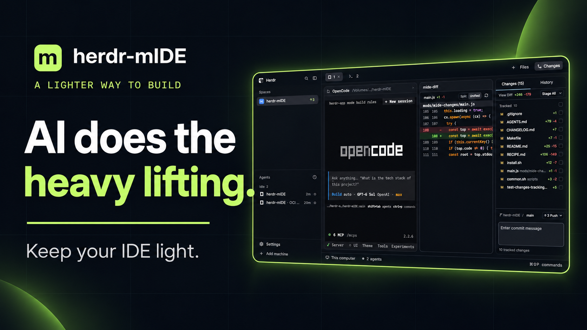

# herdr-mIDE

Herdr's familiar window gains a Files tree, a Changes panel, a diff viewer
and a small editor beside its terminals. Review an agent's changes, stage
files, commit and make small edits without changing Herdr's theme.

## What you see

- The main window keeps Herdr's spaces and agents sidebar (268px initially),
  tab bar, terminal panes and status bar. The Files and Changes buttons show
  a right panel, initially hidden, 440px wide and resizable from 300–900px.
  Herdr's shipped agents view presents working, blocked, done and idle states.
- Files has a 42px header and 26px tree rows. Folders expand to show their
  contents; their glyphs and names reflect the most severe change underneath.
  File-type icons are colored; changed names show a status letter. Ignored
  names are dimmed. Git colors are green `#a1c181`, red `#d07277`, and
  yellow `#dec184` for modified or conflicted entries. Right-clicking a row
  opens a compact, theme-colored menu at the pointer; its New File/New Folder
  actions put a single-line name input into the tree.
- Changes has a 36px Changes/History tab strip, a diff summary and stage
  action, followed by Tracked and Untracked groups with tri-state checkboxes.
  Its footer shows the repository, branch and remote action; the Changes tab
  also has a commit message area. History lists recent commits. The footer's
  repository and branch names use an end ellipsis when their available space
  runs out, keeping the remote action visible at the right edge. Names that fit
  are shown in full; a short name leaves its unused space for the other. The
  branch icon, repository, slash and branch use 1px gaps, with 1px horizontal
  padding on the branch control.
- The branch control opens a searchable popover with the current branch,
  other local branches, delete actions and an option to create a branch.
- Diff opens beside a terminal or editor with file headers, line numbers,
  additions and deletions, Split/Unified controls and a Refresh button. In
  Markdown files it colors bold-text headings, gray fence
  markers with fenced code highlighted in its inner language, gray list,
  quote and table-pipe punctuation, blue emphasis (bold for strong), orange
  inline code, orange italic link text with green URIs; bare URLs and
  strikethrough stay plain. Editor opens beside a terminal or below Diff,
  with a 36px header, unsaved dot, optional Markdown Raw/Preview tabs,
  Settings menu and 28px footer with Save. Raw Markdown uses the same editable
  host editor as other source files (⌘S or the Save control writes).
- Panel controls use Herdr's interface font and colors. Editor and diff text
  use the terminal font; their syntax uses mIDE's Ayu palette. The layout does
  not change the user's selected theme.

## How it behaves

- Click folders to expand them and files to open or reuse the current tab's
  editor. Unsaved drafts stay available while switching files in that editor.
  File and Git information refresh on local folder changes and every 10 seconds.
- Right-click a file for Open, Reveal in Finder/Explorer/file manager, Copy
  Absolute Path, Copy Relative Path and Copy Name. Folders add Open in New Tab.
  The root background offers New File and New Folder. New actions create beside
  a file, inside a folder, or at the root; Enter and blur confirm, Escape
  cancels, and invalid or duplicate names stay visible beside the input. A
  created file opens in the editor. `cmd-n`/`ctrl-n` create files and
  Zed-style `alt-cmd-n` (macOS), `alt-ctrl-n` (Linux), or `alt-n` (Windows)
  create folders when the optional `mod:mide-files` bindings have been merged.
  The menu right-aligns active shortcuts for New File, New Folder, Reveal,
  Copy Absolute Path and Copy Relative Path; it does not imply shortcuts that
  are not active. Copy Name and Open in New Tab have no assigned shortcut;
  Windows has no Copy Relative Path shortcut. Remote rows omit local
  file-manager Reveal.
- In Changes, clicking a file opens its diff; its checkbox stages or unstages
  it without opening Diff. Group checkboxes and Stage All/Unstage All act on
  their respective files. History displays up to 100 recent commits.
- Enter a commit message and submit it with Enter or Ctrl+Enter; Cmd+Enter
  also submits on macOS. The default commits staged changes;
  if nothing is staged, it stages tracked changes and commits them, excluding
  untracked files. The footer offers Fetch, Pull and Push; its primary action
  follows the upstream ahead/behind state. The branch popover switches,
  creates or deletes local branches.
- A failed Git action — a switch blocked by uncommitted changes, a missing
  branch, an unmerged delete — shows one short readable line where the action
  was taken and posts an error toast (for example "Uncommitted changes to
  .gitignore would be overwritten — commit or stash them first."), never git's
  raw multiline output. While the branch popover is open, the message appears
  only inside it; otherwise it appears in the panel. Long inline text is
  truncated to fit, with recovery guidance on a separate line when available.
- Diff shows tracked changes against HEAD and untracked files as additions.
  It refreshes, supports Split and Unified views, and uses Unified when the
  view is too narrow for Split.
- Editor's Save button writes the current file; ⌘S on macOS and Ctrl+S on
  Windows and Linux save by default, and a `mod:mide-editor` binding the
  person already merged keeps precedence. An external edit causes a save error instead of an overwrite;
  Reload discards the draft. Word wrap and the Markdown Preview default are
  persistent settings, with Markdown opening in Raw by default. Raw uses
  the host editor and supports Word wrap just like other files; Preview displays
  rendered Markdown. Remote files open in a read-only editor view: the released
  write API is local-only.

## Built from

- `layouts/herdr-mide.json` clones Herdr `main` at 0.1.13: root row with
  sidebar (`workspace-chrome`, `spaces`, `agents`, `workspace-chrome` footer)
  and work column (`tabs`, active tab with `pane` header, right panel stack,
  `workspace-status`). The `files` and `changes` blocks load the mIDE mods;
  the other named mods are shipped by Herdr.
- Four cooperating folders, all with `place: none` in `mod.json`:
  `mide-files` lists the tree, opens pointer popups, creates files/folders and
  opens the editor; `mide-changes` handles
  status, staging, commits, branches and remote Git actions; `mide-diff`
  displays comparisons; `mide-editor` edits and saves files. Files, Changes,
  Diff and Editor opt into focus. Editor receives `{file, on?}` and reads remote
  files through `readTextFile(..., {on})`; Diff receives a
  request including `{root, files, selectedPath, on, branch, title}`. The
  panel mods derive their location from the focused workspace.
- Mods use `gpui-kit`, `gpui-base` and Herdr's `spaces`, `panes`, `focused`,
  `props`, `settings`, `theme`, `window`, `shared`, `setShared`, `keys`,
  `openOverlay`, `closeOverlay`, `exec`, `watchFolder`, `notify`,
  `readTextFile`, `writeTextFile`, `nextCommand` and `run`. File creation uses
  `writeTextFile(path, "", null)` locally and `exec` with an argument-vector
  shell command remotely (the released `writeTextFile` has no `on` option).
  Commands include
  `pane.split`, `tab.new`, `mide-editor.open`, `mide-editor.save` and
  `mide-diff.open`. `keys.json` supplies optional editor and Files shortcuts
  for manual merging, not automatic replacement. Zed-style Files bindings are
  `cmd-n`/`alt-cmd-n`, `alt-cmd-r`, `alt-cmd-c` and `alt-cmd-shift-c` on
  macOS; `ctrl-n`/`alt-ctrl-n`, `ctrl-alt-r`, `ctrl-alt-c` and
  `ctrl-alt-shift-c` on Linux; and `ctrl-n`/`alt-n`, `ctrl-alt-r` and
  `alt-shift-c` on Windows.
- Local folder listings inside Herdr's granted read roots (the home folder;
  the app grants `read_roots([home()])` to every mod on every platform) run
  in-process through Herdr's fs API. A local folder outside those roots keeps
  the transports the helper always used, chosen by platform exactly as before:
  PowerShell on Windows, `sh` on macOS and Linux. Remote machines probe `sh`
  first and use PowerShell on Windows without it. Git is required for
  status, diff, history, staging, commits, branches and remote operations.
  Fetch, pull and push can contact the configured remote and use the user's
  Git/SSH credentials; commits may run Git hooks. Mods read files outside
  their own folders, and Editor writes the selected local file.
- Material Icon Theme supplies file and folder SVGs and associations; the
  chevrons come from Herdr and the branch glyph is adapted from Lucide. See `LICENSE` and
  `THIRD-PARTY-NOTICES.md` for licenses, palette sources and adaptations.
  Release bundles include these notices and the project license both at the
  root and within each mod folder so they accompany gallery-style copies.
  `shared/syntax.js` is the canonical source for Editor and Diff's syntax
  module: one file holding the per-language tokenizer registry (keyed by
  `languageFor()`) over a generic fallback tokenizer, with a dedicated
  Markdown section whose Diff rules, palette hex values and font effects are
  inspired by Zed's Markdown grammars and Ayu Dark theme. Raw editing uses
  Herdr's own syntax highlighting and the shared palette, not this tokenizer;
  its public editor API does not expose the Markdown-specific Diff scopes.
  The two mods carry
  AUTO-GENERATED in-tree `_shared/syntax.js` copies (banner-marked,
  regenerated by `sh scripts/materialize-shared.sh`, guarded by tests) so
  the repository root installs as-is.

## Watch out

- **Automation testing** and **E2E** in this project mean [`e2e/`](./e2e/) on
  `herdr-dev` ([`e2e/README.md`](./e2e/README.md)), not `just test` alone.
- This is one layout with four dependent mods, not four independent gallery
  mods. The repository root is the complete, copyable package — its mods carry
  the generated `_shared` copies in-tree. Its Git UI also
  references SVGs in `mide-files`. Preserve or
  consistently rename every cross-mod reference and asset path on conflicts.
- The layout is based on Herdr 0.1.13; validate all features against the
  supported released app and each target OS before release. Herdr's initial
  mod checker does not exercise deferred rows or interactions.
- Files limits listings to 500 entries per folder and 5,000 total; Changes
  shows the first 1,000 changed files and the branch picker up to 200 branches.
  Diff truncates large input and has syntax-highlighting budgets; inline
  Markdown coloring is limited to 4,000 characters per cell or text segment.
  Binary and conflicted files have limited views. Editor refuses to save files truncated
  past 400,000 characters and cannot edit binary files.
- Folder watch is local; remote views rely on periodic refresh. Editor reads
  remote files but is read-only there because the released write API has no
  remote-machine argument.
  Herdr grants its fs API reads inside the home folder only, on every
  platform: a project outside it (another mounted volume on macOS or Linux,
  another drive on Windows) is listed through that platform's shell transport
  instead — PowerShell on Windows, `sh` on macOS and Linux — so those folders
  need a working shell. Git operations can modify the index, worktree,
  branches and remote; test them in a disposable repository. Vim mode and
  hunk staging are not present.
- Git refresh reads disable optional locks and fsmonitor to avoid triggering
  the folder watcher with their own side effects.
- The source installer skips existing mod/layout names and prints keys rather
  than overwriting them; it is not an upgrade tool. Review name and shortcut
  conflicts before installing or manually updating. Context menu popup,
  clipboard, and file creation behavior rely on Herdr's public mod APIs.
  Uninstalling
  (`sh scripts/uninstall.sh`, recipe `just uninstall`) deletes exactly the four
  mIDE mod folders and `layouts/herdr-mide.json` from the target app home —
  Herdr's documented removal — leaving `keys.json`, shipped mods and Herdr's
  own bookkeeping untouched (including Herdr's per-layout state under
  `layouts/.state/` and the per-mod `data/` folders it creates for every
  mod); merged keys are only ever removed by hand.
  A `preview.png` must be a
  reviewed, representative screenshot with no private information.

## Done when

- Each of the four assembled mod folders passes `herdr-app check`, and the
  layout loads in the isolated `herdr-dev` profile without mod errors during
  local testing; a separate VM or test machine is not required.
- In a disposable Git repository, Files expands and marks changes; editing and
  saving works, and an external edit is not silently overwritten.
- Right-click file/folder rows show only valid actions; copy and Reveal target
  the chosen item. New File/Folder confirm, cancel, reject duplicates, and
  refresh the tree; optional shortcuts are printed for a manual keys merge.
- Changes stages and unstages files and groups; a commit with staged changes
  includes the staged content. With no staged changes, a tracked-only commit
  excludes untracked files.
- Diff opens for a changed file and switches views. Branch selection works;
  remote actions are exercised only against a disposable remote.
- A branch switch blocked by local edits fails without moving HEAD, and the
  panel shows the short blocked-files message plus an error toast rather than
  git's raw output.
- The original layout, keys, app theme and unrelated installed mods remain
  unchanged by installation; all relevant behaviors are checked on supported
  platforms before publishing.
- Uninstalling removes only the bundle's own files (the four mods and the
  layout) and is safe to repeat; keys, unrelated mods and bookkeeping stay
  byte-identical, including when the installed names are symlinks.
